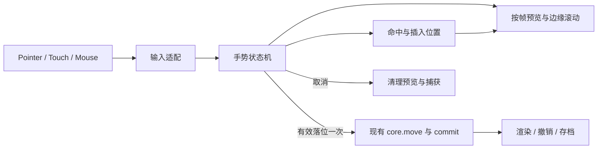

# 红警 2「从夯到拉」0.2.0 半重构计划

日期：2026-10-13  
目标版本：0.2.0  
当前基线：0.1.0  
状态：0.2.0 本地实现与候选包已完成，实际通过项及未实测范围见 [验收记录](0.2.0-验收记录.md)。本文保留实施基线。  
配套：[0.2.0 开发提示词](0.2.0-开发提示词.md)

## 1. 版本目标

让国家卡片像白板上的对象一样可以直接拿起、移动、放下：**整卡触摸拖动 → 档位高亮与插入位置预览 → 松手吸附落位 → 一次撤销恢复**。点按先选中卡片，提供清楚的选中轮廓和操作入口；不需要先找到卡片右侧的小把手。

本次“半重构”指替换交互控制与部分界面组织，沿用排名业务核心、国家素材、两版本数据、存档规则、海报生成和平台适配。继续服务 B 站 Toy 与小红书离线小工具。

本文的手势阈值、布局及模块划分是本项目的设计决策，并非 tldraw 的原始参数或默认行为。仅完成资料与代码阅读，未对 tldraw 在线产品进行真机体验测试。

## 2. tldraw 参考结论

| 查阅依据 | 参考内容 | 本项目采用方式 |
| --- | --- | --- |
| [Tools](https://tldraw.dev/docs/tools) | 工具及子状态组织输入行为 | 将按下、拖动、结束、取消写成明确状态机 |
| [Input handling](https://tldraw.dev/sdk-features/input-handling) | 集中管理输入设备与起始／当前指针位置 | 鼠标、触摸、笔统一转换为内部输入事件 |
| [Coordinates](https://tldraw.dev/sdk-features/coordinates) | 明确区分坐标空间 | 明确浏览器 client 坐标与容器坐标；本版不引入相机变换 |
| [Edge scrolling](https://tldraw.dev/sdk-features/edge-scrolling) | 拖动物体接近边缘时自动移动视图 | 拖拽状态下按时间推进文档滚动，松手立即停止 |
| [Translating 源码](https://github.com/tldraw/tldraw/blob/main/packages/tldraw/src/lib/tools/SelectTool/childStates/Translating.ts) | 移动状态分别处理完成、取消和退出清理 | 拖动只改变视觉预览，落位提交；取消清理并恢复原位置 |

采用原生 DOM 卡片与轻量交互控制器，不安装 tldraw SDK。仓库将其定位为 React 无限画布 SDK，README 也说明生产使用存在许可密钥要求；本项目需要的核心是对象拖动体验，整体引入会扩大构建与平台兼容验证范围。[项目仓库与使用说明](https://github.com/tldraw/tldraw)

本版不加入无限画布、双指相机缩放、多选框选、自由绘图和实时协作。名单只有 9／10 项，五档与待排名区保持有序布局，卡片落位后仍由档位和顺序决定位置。以后若增加相机或直接采用 SDK，应单独设计坐标、导出、依赖与平台兼容方案。

参考日期为 2026-10-13；以上 main 分支与文档链接可能变化，实施时记录实际查阅的版本或提交。借鉴交互方法，独立编写实现，不直接复制上游源文件。

## 3. 0.1.0 现状与改造范围

已阅读 `src/ui/drag.js`、`src/app.js`、`src/styles/app.css`、`src/index.template.html`、业务与存档模块，以及构建／检查／打包脚本。

| 当前实现 | 0.2.0 调整 |
| --- | --- |
| 只有 `.drag-handle` 可开始拖动；主体点按打开定档弹窗 | 整卡作为拖拽热区；点按选中，通过“调整档位”按钮打开现有面板 |
| 单文件混合输入监听、手势判断、命中、滚动及兼容点击抑制 | 拆分输入、纯状态转换、几何命中和视觉控制职责 |
| 以曼哈顿距离大于 7px 判断起拖 | 按设备使用可配置的欧氏距离阈值，单位为 CSS px |
| 指针移动时读取影子尺寸并修改 left/top | 起拖测量一次，按帧更新 transform；批量读取几何信息 |
| 在 document 上监听移动与松手，没有显式 pointer capture | 优先稳定根节点捕获指针；能力不足时使用 document 监听回退 |
| 全页边缘按每帧固定速度滚动 | 按实际可用视口、底栏遮挡和经过时间计算滚动速度 |
| 通过多处时间窗口处理触摸兼容点击 | 单一激活入口与有边界的点击去重，覆盖下一次真实点击 |
| 安装拖拽后不返回卸载接口 | 提供 cancel、destroy、isDragging，统一结束所有监听与帧任务 |
| 构建检查硬编码 20 个文件、8 个脚本 | 新模块接入时同步生产清单与脚本顺序检查，继续严格检查额外文件 |

以上是实现事实及改造目标，不把尚未复现的边界情况称为已确认缺陷。0.1.0 的既有通过记录保留，新版需要重新验收。

### 保留边界

- 国家 ID、原版 9 国、尤复 10 项及现有本地图标不变。
- 五档 ID 与待排名区不变；所有国家恰好出现一次。
- `core.move` 的 index 仍表示“从原位置移除后，在目标列表中插入的位置”。
- 继续使用 `schemaVersion: 1` 与 `ra2-tier-list:save:v1`。应用版本升级不等于存档格式升级。
- 选中项、手势、浮动卡片、候选落点、滚动状态只在内存中，不写入草稿。
- 两版本排名、标题和最多 20 次会话撤销独立；一次拖放最多提交一次。
- 标题 30 个 Unicode 码点、重置确认、损坏存档保护与 1080／720px 海报维持原规则。

## 4. 用户交互规范

### 4.1 统一操作规则

| 用户动作 | 响应 |
| --- | --- |
| 单指点按国家卡片，不超过起拖阈值 | 选中卡片，显示轮廓及“调整档位、前移、后移、移回待排名”操作区 |
| 单指从卡片任意位置移动超过阈值 | 直接拿起卡片，无需长按、无需先选中 |
| 拖到另一档／待排名区 | 高亮目标区域，显示明确的插入指示线 |
| 在同一档移动 | 预览档内插入位置；松手后更新顺序 |
| 松手于有效目标 | 吸附到布局位置；成功移动后保留该卡片选中状态 |
| 松手于无效区域 | 回到原位；排名、草稿与撤销历史不变 |
| 点击榜单空白 | 取消选中；工具栏和其他按钮不视为榜单空白 |
| 从档位标签或卡片外留白纵向滑动 | 正常滚动页面，不产生拖拽 |
| 鼠标左键／笔尖拖动 | 采用同一落位规则，保留按下时的抓取位置 |
| 键盘聚焦卡片后 Enter／Space | 选中；可通过操作区完成全部分档与重排 |
| 拖拽中按 Esc／点击取消按钮 | 取消手势并回位；未拖拽时 Esc 取消选中 |

选中操作区应占据预留区域或浮层，不能出现时推移榜单。手机使用底部安全区上方的操作区，拖拽时显示“拖到目标档位”和取消按钮，屏蔽修改排名的操作；结束后恢复。弹窗焦点陷阱、关闭及焦点恢复继续有效。按钮热区至少 44×44px。

默认阈值：触摸 8px，鼠标／笔 4px；必须用 CSS px，不能乘 devicePixelRatio。阈值是调试起点，后续根据真机记录调整。长按不触发新功能，避免成为必经操作。

### 4.2 滚动与拖动的明确分工

卡片在手势开始之前就设置 `touch-action: none`，从卡片起手意味着操作卡片。档位标签、容器留白与页面外围保留原生纵向滚动路径；手机档位标签形成至少 44px 宽的连续滚动区域，待排名区也要保留明确留白，并显示一次性简短提示“拖卡片定档，滑动左侧档位或空白滚动”。

不能承诺同一次、同一区域的单指纵滑同时完成“直接拖卡片”和“原生滚动”。也不能在移动超过阈值后才设置 `touch-action: none` 来争夺已经开始的浏览器手势。[Pointer Events 对直接操作与 touch-action 的规定](https://www.w3.org/TR/pointerevents3/#the-touch-action-css-property)

本版使用一个文档纵向滚动层，不给榜单、待排名区分别增加嵌套滚动容器。卡片外不全面阻止浏览器手势，不设置禁止用户缩放的 viewport 参数。

### 4.3 多指与异常中断

- 单指交互期间出现第二触点：立即取消卡片手势，进入等待所有触点释放的状态；不把剩余手指提升为新拖拽，也不提交移动。
- pointercancel、意外 lostpointercapture、窗口失焦、页面隐藏、组件销毁：同一路径取消并清理。
- 旋转屏幕、可用视口改变、版本切换、重置、打开弹窗或开始导出：先取消未完成手势，再执行对应动作；不能使用旧几何信息提交。
- 不主动实现双指缩放榜单；在卡片外由浏览器和宿主决定原生缩放。卡片上发生的第二触点只保证安全取消。
- 收到重复结束事件必须幂等；一次松手不得重复提交、重复选中或打开弹窗。

## 5. 视觉与命中规则

保留深灰红警面板、五档色条和国家旗帜。缩短手机顶部介绍，把榜单及待排名入口提前；保留桌面的榜单／待排名双栏。卡片主体统一为一个可聚焦操作元素，原把手可作为装饰提示，避免重叠按钮和两个激活入口。

- 按下后有轻微反馈；超过阈值才出现浮动卡片和原位占位。
- 原卡片保留尺寸，不因拿起导致列表回流；浮动层 `pointer-events: none`，不进入可访问树，不复制重复 id。
- 触摸影子可向上偏移约 20px，减少手指遮挡；这是视觉偏移，命中仍使用真实 clientX/clientY。鼠标不强制偏移。
- 命中先识别可见档位／待排名的卡片区域。档位文字标签与工具栏不作为落点，避免遮挡区域误投。
- 目标卡片列表排除当前拖动项；按视觉行分组，先选行、再以卡片中心决定前后。空档返回 index=0；行间空白、尾部空白、换行首尾都必须有确定规则及用例。
- 插入线不参与布局和命中；仅用高亮与指示线做预览，避免连续回流造成落点抖动。
- 手指离开有效目标即清除候选位置，不能沿用上一个目标。pointerup 时使用最后松手坐标同步重算，再决定提交。
- 落位动画建议 120–180ms；尊重 prefers-reduced-motion，不依赖动画完成才提交业务状态。

## 6. 交互架构

### 6.1 状态机

| 状态 | 进入／变化 | 退出结果 |
| --- | --- | --- |
| idle | 卡片主指针按下 → pressing | 记录国家、版本、来源、按下坐标与手势编号 |
| pressing | 距离越阈值 → dragging；正常松手 → idle | 未拖动松手只选中；取消不选择 |
| dragging | 更新最新坐标、候选落点、视觉和滚动 | 有效松手提交一次；无效松手／取消零提交 |
| blocked | 第二触点介入，取消正在进行的卡片手势 | 所有相关触点释放后回到 idle |

selectedCountryId 是独立的视图状态，不作为业务排名，也不与 dragging 混在同一枚举里。保存 previousSelection，取消可恢复它；成功落位选中移动项。切换游戏版本清空选中项。

### 6.2 文件职责及接口

建议采用以下拆分；函数保持小而明确，避免引入通用编辑器框架。

| 文件 | 动作与职责 |
| --- | --- |
| `src/ui/interaction/input.js` | 新建；归一化输入、跟踪触点、捕获／释放及兼容事件去重 |
| `src/ui/interaction/session.js` | 新建；纯状态转换，返回 select／preview／commit／cancel 等效果，不直接接触 DOM |
| `src/ui/interaction/hit-test.js` | 新建；矩形命中、换行列表插入索引、可用视口计算 |
| `src/ui/drag.js` | 重写为控制器，连接输入与状态机、预览、rAF 和边缘滚动 |
| `src/app.js` | 调整卡片结构、选中操作区、取消调用与 commit 接口；保留原业务函数 |
| `src/styles/app.css` | 整卡触屏区域、选中态、拖动层、插入线及移动布局 |
| `src/index.template.html` | 添加选择操作区、交互说明与外部脚本依赖顺序 |
| `scripts/build.mjs`、`scripts/package.py`、`scripts/check-artifacts.mjs` | 同步生产清单、脚本数量／顺序和版本化输出；不通过删除严格检查来适配 |
| `tests/interaction.test.cjs` | 新增状态机与几何规则测试 |
| 浏览器脚本与文档 | 更新交互选择器和触摸断言，记录实际测试条件 |

控制器约定：`installDrag(root, options)` 返回 `{ cancel(reason), destroy(), isDragging() }`。options 至少提供 disabled、getVersion、select(id)、move(id, location, index)。业务提交由 app 完成，控制器不得自行写存档或操作撤销栈。

脚本顺序：现有数据／业务核心／对话框 → interaction 模块 → drag → 海报／平台 → app。浏览器产物仍为 ES2017 外部经典脚本，Node 构建脚本可继续使用现有模块形式。

### 6.3 指针生命周期与点击去重

Pointer Events 优先，主指针按下后在稳定的交互根节点调用 setPointerCapture；先做能力检测与异常保护。跟踪其他触点时不能仅过滤 isPrimary，否则无法触发双指取消。捕获期间命中使用坐标／矩形，不能使用被重定向到捕获节点的 event.target 作为落点。[Pointer capture 规范](https://www.w3.org/TR/pointerevents3/#pointer-capture)

未提供 Pointer Events 时使用 Touch.identifier 跟踪主触点，并提供鼠标回退；一次只安装一套适配器，避免同手势被多套监听处理。Touch 回退在卡片触点开始时就建立阻止原生滚动的路径，避免等浏览器开始滚动才 preventDefault；只对可取消的对应事件操作。

统一由手势结束派发 select／move，键盘激活走独立可识别入口。兼容 click 去重绑定已处理手势及有效期；新真实 pointerdown／touchstart 清除旧令牌。不得无限期吞掉下一次点击，不能仅按国家 ID 屏蔽不同的后续操作。销毁时撤销所有 document／window 监听，清除捕获、定时器、rAF、样式与影子。

### 6.4 帧调度与边缘滚动

事件监听只保存最新坐标；每个动画帧最多一次几何读取批次与一次预览写入批次。拖动中不整榜 render、不序列化存档、不压入历史。坐标与 getBoundingClientRect 统一使用 client 空间；文档滚动、布局改变后重新测量，不重复叠加 scrollY。

沿用文档滚动层。有效视口取窗口或可用 visualViewport 与工作区的交集，扣除实际遮挡的操作栏。顶部／底部边缘带初值 48px，停留 120ms 后启用，速度随接近边缘递增，上限 600 CSS px/s。使用 rAF 时间差积分，单帧 dt 上限 32ms；不按固定“每帧几像素”计算。上述数值均为本项目初始参数。

滚动到边界停止推进，保持命中反馈；退出边缘停止滚动。手指静止时，滚动每帧仍重新计算落点；取消和松手立即停止。页面恢复前台不得补偿后台停留时间。保留浏览器缺少 visualViewport 时的 innerHeight 回退。

## 7. 平台、存档和发布兼容

- 不增加 React、tldraw SDK、网络依赖、远程字体或新运行服务。
- 延续 0.1.0 小红书产物约束：外部经典脚本、相对路径、本地资源，不混入 Toy 下载代码；无运行时模块、动态执行与被禁宿主能力。
- 小红书保存链路及 Toy 适配器维持现有行为，实施时按本机对应技能再核对平台规定。
- Chrome 61 作为兼容目标，不因现代浏览器验证通过就宣称支持；能力必须检测，旧内核单独记录。
- 用户 0.1.0 草稿无迁移即可读取；导出始终读取已提交业务状态，不导出拖动影子、选择轮廓或插入线。
- 实现完成时再将 package.json 版本改为 0.2.0，生成 `release/ra2-tier-list-toy-0.2.0.zip` 与 `release/ra2-tier-list-xhs-0.2.0.zip`，保留已交付的 0.1.0 ZIP。
- 构建文件清单增加时检查名单一致性，废弃 dist 文件需明确识别后移除，不能把旧文件静默打包。

## 8. 分阶段实施与退出条件

| 阶段 | 工作 | 退出条件 | 估算 |
| --- | --- | --- | --- |
| M0 基线 | 检查当前修改，复测业务，准备旧草稿样例与现有包备份信息 | 有可回退基线；不清理用户真实草稿 | 0.5 天 |
| M1 输入与状态 | 输入适配、状态机、生命周期、单次提交及多指取消 | 纯逻辑测试通过；可在开发环境走通完整手势 | 1 天 |
| M2 卡片与落位 | 整卡拖动、选中工具区、几何命中、影子与插入线 | 触摸／鼠标跨档、同档换行排序、取消均正确 | 1 天 |
| M3 移动适配 | 滚动分工、视口与边栏遮挡、边缘滚动、兼容点击 | 320–430px 可完成全部操作，连拖连点无误触 | 1 天 |
| M4 回归与候选包 | 旧存档、导出、两版本、两平台构建与审计 | 自动检查通过；产出 0.2.0 候选包及验收记录 | 0.5–1 天 |

预计 4–4.5 个开发日；真机与平台审核等待时间另计。可以按阶段分次推进，不能将估算当作完成承诺。回退以恢复交互与模板／样式改动为主，业务格式保持 v1。

## 9. 验收清单

以下为原定验收清单，勾选状态不作为完成凭证；本次实际结果见 [验收记录](0.2.0-验收记录.md)。0.1.0 的 9 项单元测试和 51 项浏览器检查是回归基线。旧的“点按立即弹窗”和“只有把手能拖”的断言已更新；数据、存储、导出与异常保障继续保留。

### 必须通过的自动与浏览器检查

- [ ] 无需长按或先选中，从国旗／名称／卡片边缘都能起拖；轻微抖动只产生一次选中。
- [ ] 跨档、同档前后移动、换行首尾、空档、待排名回收均无重复／遗漏；插入索引符合 core.move 契约。
- [ ] 一次落位恰好一条历史；原位释放、无效落点、取消、双指干扰均零新增历史。
- [ ] pointerup 坐标不同于最后一次 move 时，最终目标仍正确。
- [ ] 拖拽后立即点同卡、另一卡、工具栏、打开并关闭弹窗，均不丢失真实点击或发生穿透。
- [ ] 第二触点加入后取消，所有手指抬起后下一次手势正常；Pointer 与 Touch 回退都覆盖。
- [ ] pointercancel、丢失捕获、Esc、隐藏、失焦、旋转、版本切换、导出和销毁都无影子或滚动残留。
- [ ] 反复安装／销毁控制器不积累监听；重复结束不重复提交。
- [ ] 从留白与左侧标签可滚动；从卡片起手只拖卡片；10 项同档时也有可用滚动路径。
- [ ] 顶部／底部边缘滚动均可把待排名项目送到最远档位；停指滚动时指示线持续准确；被底栏覆盖处不能投放。
- [ ] 320、375、390、430、768、1280px 无横向溢出；横竖屏、软键盘与安全区不遮挡主要操作。
- [ ] 键盘可完成选中、分档、重排、取消与导出；焦点可见，状态消息不在每次 move 时重复播报。
- [ ] 旧 v1 草稿恢复、两版本隔离、损坏／未知 schema 保护、配额不足仍符合原规则。
- [ ] 空榜、部分排名、所有国家同档、最长标题及轻量导出正确；结果图不包含交互装饰。
- [ ] Toy 子路径资源与两个最终 ZIP 检查通过；小红书包目录／ZIP 审计无阻断问题。

### 真机和性能记录

- 至少记录一次 Android 与一次 iOS 真机触摸结果，区分普通浏览器、B 站 App、小红书容器；缺少设备则写“未实测”。
- 平台容器中记录完整连续操作：拖入最远档位 → 档内重排 → 移回待排名 → 撤销 → 导出。
- 记录设备、系统、WebView／浏览器版本、视口、卡片数量、拖动录屏与问题；Chrome 模拟触摸不能替代真机结论。
- 以 60Hz 下接近 60fps、单帧工作尽量少于 16.7ms 为体验目标，记录性能追踪结果；未测量不宣称达标。
- 真机尚未覆盖时可以交付“本地候选包”，不能标记“平台全量验收完成”。

## 10. 完成后的交付物

0.2.0 源码、更新后的使用说明、两平台带版本号 ZIP、拖动中／落位后手机截图、浏览器及真机验收记录，以及旧草稿兼容说明。上传平台和审核属于后续发布动作，本计划不执行这些动作。
