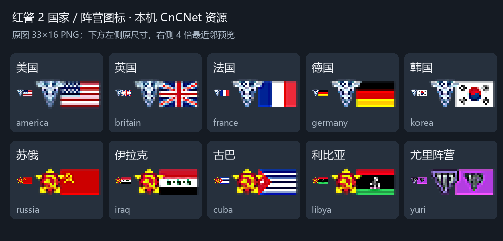

# 国家／阵营图标提取记录

日期：2026-10-12。

已从本机 `D:\Red_Alet_II\CNCNET\Resources` 复制 10 张 PNG 到 `assets/countries/`，文件名与开发计划的稳定 ID 对应。原文件保持不变；目标文件经字节比对与 SHA-256 校验，与源文件完全相同。

这套素材是本机 CnCNet 客户端的国家选择图标，包含阵营徽记与国旗；本次没有从原版 MIX 包解码，不将其称为已验证的原版官方菜单素材。

| ID | 名称 | 原文件 |
| --- | --- | --- |
| america | 美国 | Americaicon.png |
| britain | 英国 | Great Britainicon.png |
| france | 法国 | Franceicon.png |
| germany | 德国 | Germanyicon.png |
| korea | 韩国 | Koreaicon.png |
| russia | 苏俄 | Russiaicon.png |
| iraq | 伊拉克 | Iraqicon.png |
| cuba | 古巴 | Cubaicon.png |
| libya | 利比亚 | Libyaicon.png |
| yuri | 尤里阵营 | Yuriicon.png |

全部为 **33×16、RGBA 透明背景 PNG**，总计 **10,220 字节**。原版使用前 9 项，尤复使用全部 10 项。苏俄是苏联旗帜，尤里是阵营标志；利比亚等图案保留客户端中的历史样式，不替换成现代现实国旗。

适合在卡片内按原尺寸或整数倍展示。原图分辨率较低，4 倍预览使用最近邻放大，不代表高清素材。需要大幅海报时可保留像素风，或另行寻找更高分辨率资源。



来源、尺寸、版本和哈希记录在 `assets/asset-manifest.json`。本次未从本地文件确认各图片的单独授权信息，清单将状态如实记为未确定。

复现方式（使用已安装 Pillow 的 Python）：

```powershell
python scripts/extract-country-icons.py 'D:\Red_Alet_II\CNCNET\Resources'
```

脚本先验证全部源图；遇到与现有目标内容不同的文件会停止，避免覆盖已有素材。预览和提取说明是开发文档，不需要放进平台运行包。
